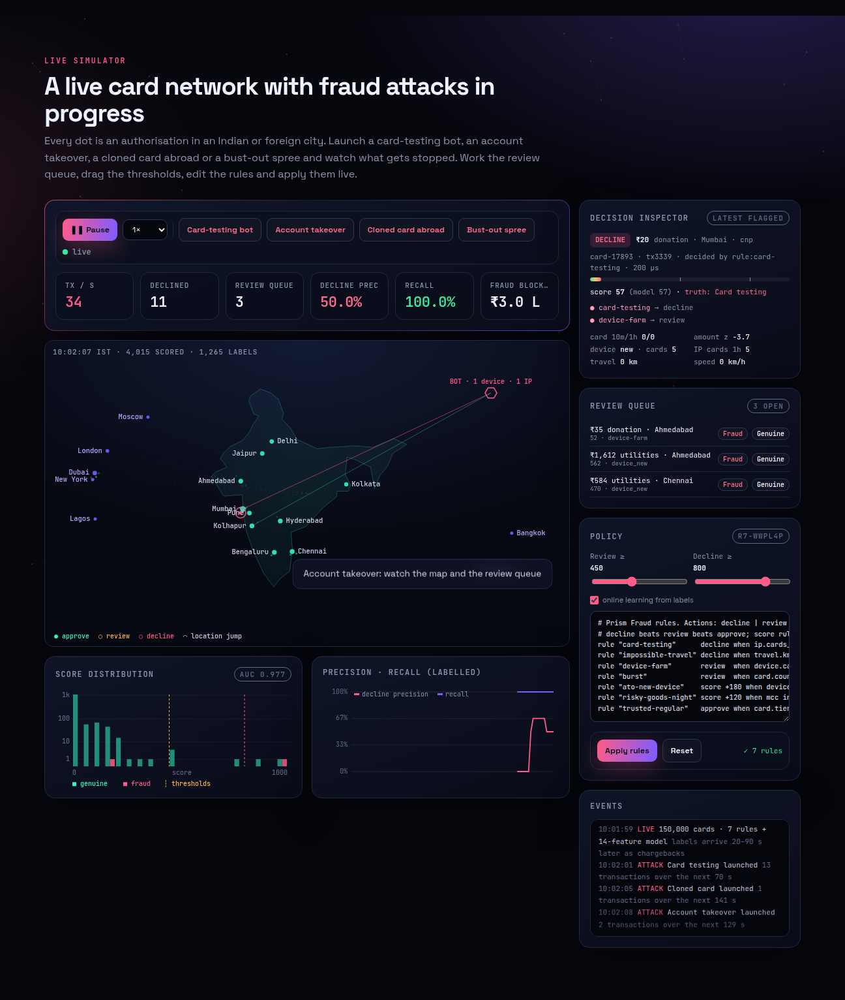
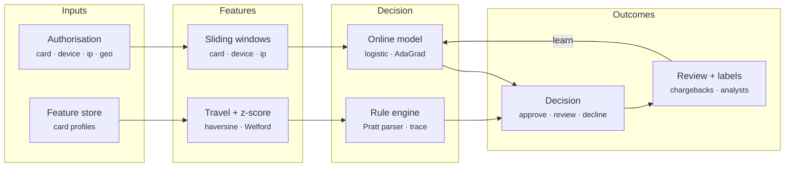
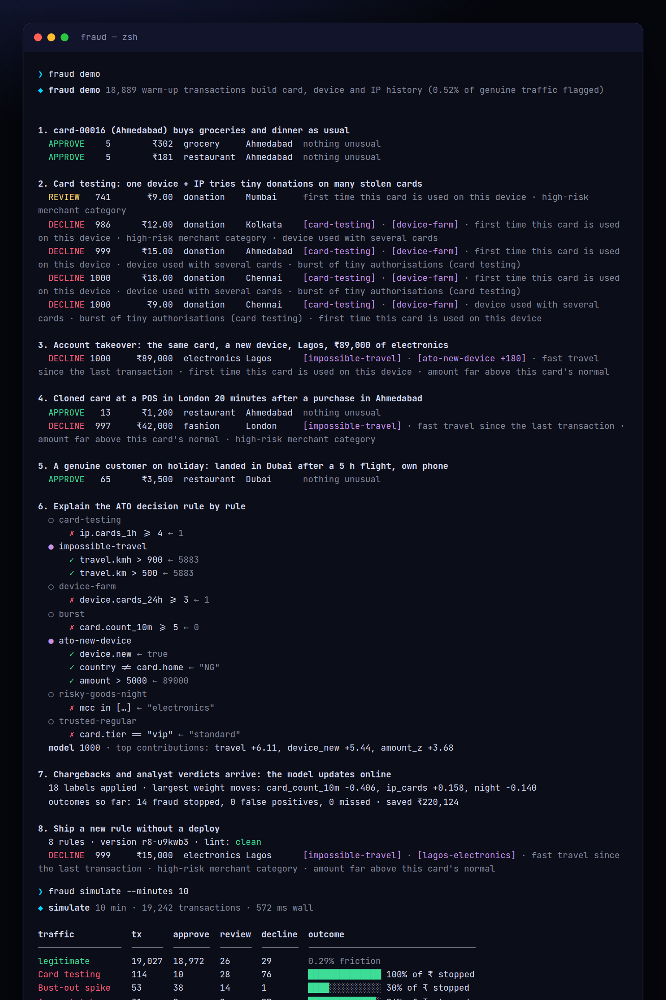
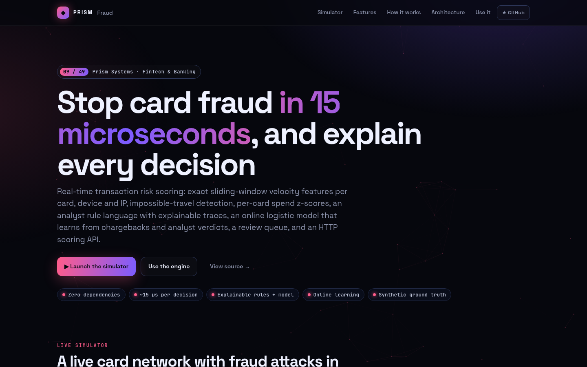
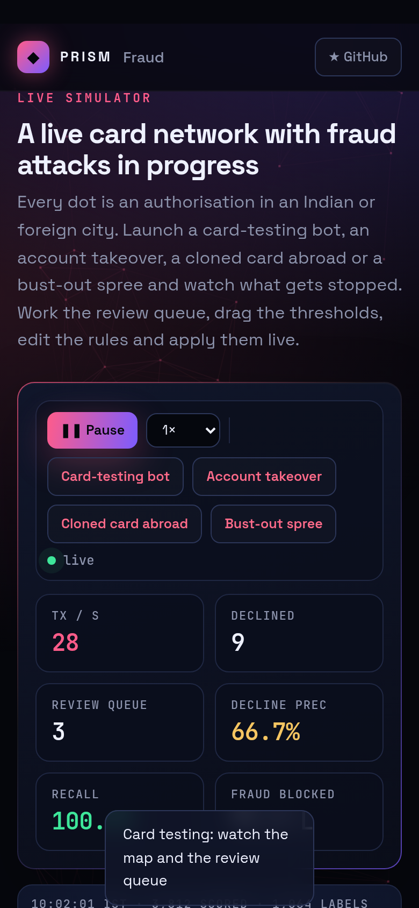

<!-- Prism Systems 09/49 -->
<p align="center">
  
</p>

<p align="center">
  
</p>

<p align="center">
  <a href="https://github.com/krishyaa06/prism-fraud/actions/workflows/ci.yml"></a>
  <a href="https://krishyaa06.github.io/prism-fraud/"></a>
  
  
  
  <a href="LICENSE"></a>
</p>

<p align="center">
  <a href="https://krishyaa06.github.io/prism-fraud/"><b>Live simulator</b></a> ·
  <a href="docs/ARCHITECTURE.md"><b>Architecture</b></a> ·
  <a href="docs/USAGE.md"><b>Docs</b></a> ·
  <a href="#-quick-start"><b>Quick start</b></a>
</p>

<p align="center">
  <a href="https://krishyaa06.github.io/prism-fraud/"></a>
</p>


## ⚡ Overview

Card fraud is decided in the few milliseconds between a tap and the terminal beeping. Issuers and payment processors answer with layered defences: velocity features over time windows, location and spend anomalies, analyst-written rules for known patterns, and a model for everything else, all explainable to an analyst and a regulator. Prism Fraud is a compact implementation of that stack with the parts that matter in practice: exact windows, rules that people can read, a model that keeps learning, and honest measurement against ground truth.

## ✨ Features

| | Feature | Details |
| :-: | --- | --- |
| ⏱ | **Exact sliding windows** | Per-card counts and sums over 10 min, 1 h and 24 h, distinct cards per device (24 h) and per IP (1 h), tiny-authorisation bursts per IP. Pruning is O(1) amortised; there is no approximation. |
| ✈ | **Impossible travel** | Haversine distance from the card's last approved location divided by elapsed time. A Mumbai purchase followed by London 20 minutes later is 22,000 km/h. |
| σ | **Spend profile** | A Welford running mean and variance of log amounts per card gives a z-score, so ₹40,000 is normal for one customer and extreme for another. |
| ⌘ | **Rule language** | `decline`, `review`, `approve` and `score +N` rules with `and or not in`, arithmetic, lists and `5k` / `2m` suffixes. Errors come with line and column, and a linter catches unknown fields. |
| ◉ | **Explainable** | Every comparison records the value it saw (`travel.kmh > 900 ← 22,431`), and the model reports its top feature contributions in plain language. |
| ∿ | **Online model** | A 14-feature logistic regression with AdaGrad and L2, class-weighted for rare fraud. Chargebacks and analyst verdicts update it as they arrive. |
| ☰ | **Review queue** | Borderline transactions open a case. Analyst decisions label the transaction, close the case and train the model, and outcome metrics track precision, recall and money saved. |
| ⚡ | **HTTP API** | `POST /v1/score` (with `?explain`), `POST /v1/label`, case endpoints, `GET /v1/metrics` and `PUT /v1/rules` for hot reload. |

## 🏗️ Architecture



### How it works

1. **Look up** — The card's profile comes from the feature store the first time it is seen: home country, tier, known devices, spend distribution and last location.
2. **Featurise** — Windows for card, device and IP are queried before the transaction is recorded, plus z-score, travel speed, merchant category risk and channel.
3. **Score** — The model turns 14 features into a probability (score 0–1000). Rules then run against the same context, and `score` rules adjust it.
4. **Decide** — Decline beats review beats approve. An approve rule can override a model review but never a decline. Thresholds are configurable.
5. **Learn** — Chargebacks, confirmed-good labels and analyst verdicts arrive later and update both the outcome metrics and the model weights.

More detail in [docs/ARCHITECTURE.md](docs/ARCHITECTURE.md).

## 🚀 Quick Start

**Try it in the browser:** [https://krishyaa06.github.io/prism-fraud/](https://krishyaa06.github.io/prism-fraud/), no install needed.

```bash
# CLI, no install
npx github:krishyaa06/prism-fraud --help

# add the engine to a project
npm install github:krishyaa06/prism-fraud
```

### JavaScript API

```js
import { FraudEngine } from "prism-fraud";

const fraud = new FraudEngine({
  rules: `rule "card-testing" decline when ip.cards_1h >= 4 and amount < 100
          rule "impossible-travel" decline when travel.kmh > 900 and travel.km > 500
          rule "ato" score +180 when device.new and country != card.home and amount > 5k`,
  review: 450, decline: 800,
  profiles: (cardId) => featureStore.get(cardId),   // optional history: devices, spend, last location
});

const r = fraud.score({
  id: "tx-91", t: Date.now() / 1000, card: "card-00042", amount: 64999, mcc: "electronics",
  city: "Lagos", country: "NG", lat: 6.52, lon: 3.38, device: "dev-9", ip: "203.0.113.7", channel: "cnp",
}, { explain: true });

r.decision;   // "decline"
r.score;      // 0..1000
r.by;         // "rule:impossible-travel"
r.reasons;    // [{ kind: "rule", name: "ato", delta: 180 }, { kind: "model", why: "first time this card is used on this device" }]
r.trace;      // every rule, every comparison, every value seen

fraud.label("tx-91", true);          // chargeback -> outcome metrics + online model update
fraud.openCases();                   // review queue
fraud.setRules(src);                 // hot reload
fraud.metrics();                     // { auc, precision, recall, savedAmt, lostAmt, ... }
```

| Export | What it does |
|---|---|
| `new FraudEngine({ rules, model, review, decline, learn, profiles, maxHistory })` | The decision engine |
| `.score(tx, { explain })` | `{ decision, score, modelScore, by, reasons, ctx, x, us, trace? }` |
| `.label(id, fraud, { source })` · `.resolve(id, fraud)` | Ground truth and analyst verdicts (each applied once) |
| `.openCases()` · `.cases` · `.metrics()` · `.stats` · `.outcomes` · `.on(fn)` | Review queue, AUC / precision / recall / money saved, events `decision` and `label` |
| `.setRules(src)` · `.registerCard(profile)` · `FraudEngine.fields()` | Hot reload, seed history, known rule fields |
| `new RuleSet(src)` · `.run(ctx, explain)` · `.lint(fields)` · `parseRules` · `tokenize` · `evaluate` · `RuleError` | Rule language |
| `new Logistic({ weights, bias, lr, l2, posWeight })` · `.prob` · `.update` · `.fit` · `.explain` · `FEATURES` · `auc` · `confusion` | Model |
| `Series` · `Distinct` · `Welford` · `km` | Window and statistics primitives |
| `new Traffic({ seed, customers, rate, fraud })` · `.step(dt)` · `.attack(kind)` · `.profile(card)` · `KINDS` | Synthetic traffic with ground truth |
| `createServer(engine)` from `src/node/server.js` | HTTP API |

### CLI

```bash
$ npx github:krishyaa06/prism-fraud demo
$ npx github:krishyaa06/prism-fraud score examples/tx.json
$ npx github:krishyaa06/prism-fraud simulate --minutes 10
$ npx github:krishyaa06/prism-fraud train --hours 24
$ npx github:krishyaa06/prism-fraud rules examples/rules.fraud
$ npx github:krishyaa06/prism-fraud bench
$ npx github:krishyaa06/prism-fraud serve --port 8787
```

<p align="center"></p>

| Command | Description |
|---|---|
| `fraud demo` | Normal spending, card testing, ATO, cloned card, genuine travel, a full rule trace, online learning, hot reload |
| `fraud score [tx.json \| --amount --mcc --city --device --ip --card]` | Score one transaction against warmed-up history and explain it |
| `fraud simulate [--minutes 10 --rate 30 --seed 9]` | Live traffic with attacks; per-pattern outcomes, AUC, precision, recall, latency |
| `fraud train [--hours 24] [--save]` | Train from scratch on synthetic history, evaluate on a holdout, optionally write `src/weights.js` |
| `fraud rules [file.fraud] [--strict]` | Parse and lint a rule file |
| `fraud bench [--n 100000]` | Throughput and latency percentiles |
| `fraud serve [--port 8787]` | HTTP API |

## 📸 Screenshots

<table>
  <tr>
    <td width="68%"></td>
    <td width="32%"></td>
  </tr>
</table>

## 🧠 Design Decisions

- **Features before recording.** The context is computed from state before the transaction is added, so a transaction never counts towards its own velocity, and declined attempts do not move the card's spend profile or last location.
- **Exact, cheap windows.** Events are kept in append-only arrays with a moving head; short windows scan backwards only through events inside them. Typical per-card history is tiny, so this beats approximate sketches on both accuracy and speed here.
- **Rules and model together.** Rules encode what analysts know today and can be shipped in seconds; the model generalises. `score` rules let analysts nudge the model rather than override it.
- **Decline wins.** An approve (allow-list) rule can rescue a model review but never a decline rule, so a VIP list cannot become a hole.
- **Learn from delayed labels.** Chargebacks arrive weeks later in reality (seconds in the simulator). Features are stored with each decision so the model trains on exactly what it saw.
- **Measure in money.** Outcomes track fraud amount stopped, missed and genuine amount declined, not just counts.

## 🏭 Production Notes

The decision path is complete and tested. A production deployment also needs:

- A real feature store (Redis, Aerospike or a stream processor such as Flink) shared by all scoring nodes, with windows partitioned by card / device / IP.
- Device fingerprinting and IP intelligence (proxy, VPN, ASN reputation) as additional features, plus 3-D Secure step-up as a fourth outcome.
- Models trained offline on real labelled history (gradient-boosted trees are the industry default), with champion / challenger testing, drift monitoring and calibration.
- Label pipelines from chargebacks (with reason codes), confirmed-fraud reports and analyst tools, accounting for label delay and selection bias (declined transactions never get chargebacks).
- Case management with SLAs, audit trails for every decision, and model governance documentation.

## 📁 Project Structure

```text
prism-fraud/
├── assets/
│   └── logo.svg
├── bin/
│   └── fraud.js
├── css/
│   └── app.css
├── docs/
│   ├── ARCHITECTURE.md
│   └── USAGE.md
├── examples/
│   ├── rules.fraud
│   └── tx.json
├── js/
│   └── app.js
├── src/
│   ├── lib/
│   │   ├── cli.js
│   │   ├── rng.js
│   │   └── sha256.js
│   ├── node/
│   │   └── server.js
│   ├── data.js
│   ├── engine.js
│   ├── index.js
│   ├── model.js
│   ├── rules.js
│   ├── sim.js
│   ├── weights.js
│   └── window.js
├── test/
│   └── fraud.test.js
├── .gitignore
├── LICENSE
├── README.md
├── index.html
└── package.json
```

## 🧪 Tests

```bash
npm test
```

The test suite uses the built-in `node:test` runner, so there is nothing to install. CI runs it on Node 20 and 22.

## 🗺️ Roadmap

- [ ] Gradient-boosted trees option
- [ ] 3-D Secure step-up outcome
- [ ] Graph features (shared devices / IPs between cards)
- [ ] Champion / challenger models

## 🤝 Contributing

1. Fork the repo and create a branch: `git checkout -b feat/my-idea`
2. Make your change in `src/` and add a test in `test/`
3. Run `npm test`, then open a Pull Request

## 🔷 Part of Prism Systems

**Prism Fraud** is system **09 of 49** in **Prism Systems**, a series of open-source reference implementations of large-scale infrastructure by [Prism Protocol](https://dc.gg/prismprotocol). Each one ships a real engine, a CLI and a live simulator, all with zero dependencies.

## 👤 Author

<table>
  <tr>
    <td align="center">
      <a href="https://github.com/krishyaa06"><br><b>Soumya Bhandare</b></a><br>
      <sub>Founder @ Prism Protocol</sub>
    </td>
    <td>
      <a href="https://dc.gg/prismprotocol"></a><br>
      <a href="https://instagram.com/prism_protocol_"></a><br>
      <a href="https://x.com/krishyaa06"></a>
    </td>
  </tr>
</table>

## 📄 License

Released under the [MIT License](LICENSE).

<p align="center">
  <b>If this helped you learn something, consider giving it a ⭐</b><br>
  <sub>"Build. Create. Compete." · Made with ⚡ by Prism Protocol</sub>
</p>


