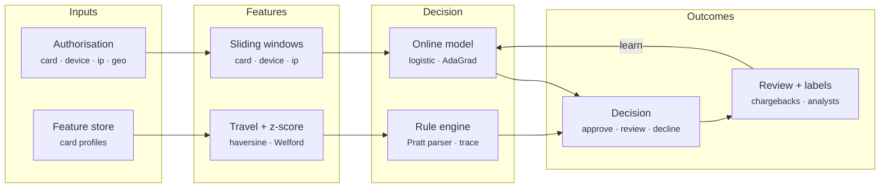

# Prism Fraud — Architecture

Card fraud is decided in the few milliseconds between a tap and the terminal beeping. Issuers and payment processors answer with layered defences: velocity features over time windows, location and spend anomalies, analyst-written rules for known patterns, and a model for everything else, all explainable to an analyst and a regulator. Prism Fraud is a compact implementation of that stack with the parts that matter in practice: exact windows, rules that people can read, a model that keeps learning, and honest measurement against ground truth.

## System diagram

## How it works

1. **Look up** — The card's profile comes from the feature store the first time it is seen: home country, tier, known devices, spend distribution and last location.
2. **Featurise** — Windows for card, device and IP are queried before the transaction is recorded, plus z-score, travel speed, merchant category risk and channel.
3. **Score** — The model turns 14 features into a probability (score 0–1000). Rules then run against the same context, and `score` rules adjust it.
4. **Decide** — Decline beats review beats approve. An approve rule can override a model review but never a decline. Thresholds are configurable.
5. **Learn** — Chargebacks, confirmed-good labels and analyst verdicts arrive later and update both the outcome metrics and the model weights.

## Design decisions

- **Features before recording.** The context is computed from state before the transaction is added, so a transaction never counts towards its own velocity, and declined attempts do not move the card's spend profile or last location.
- **Exact, cheap windows.** Events are kept in append-only arrays with a moving head; short windows scan backwards only through events inside them. Typical per-card history is tiny, so this beats approximate sketches on both accuracy and speed here.
- **Rules and model together.** Rules encode what analysts know today and can be shipped in seconds; the model generalises. `score` rules let analysts nudge the model rather than override it.
- **Decline wins.** An approve (allow-list) rule can rescue a model review but never a decline rule, so a VIP list cannot become a hole.
- **Learn from delayed labels.** Chargebacks arrive weeks later in reality (seconds in the simulator). Features are stored with each decision so the model trains on exactly what it saw.
- **Measure in money.** Outcomes track fraud amount stopped, missed and genuine amount declined, not just counts.

## Production notes

The decision path is complete and tested. A production deployment also needs:

- A real feature store (Redis, Aerospike or a stream processor such as Flink) shared by all scoring nodes, with windows partitioned by card / device / IP.
- Device fingerprinting and IP intelligence (proxy, VPN, ASN reputation) as additional features, plus 3-D Secure step-up as a fourth outcome.
- Models trained offline on real labelled history (gradient-boosted trees are the industry default), with champion / challenger testing, drift monitoring and calibration.
- Label pipelines from chargebacks (with reason codes), confirmed-fraud reports and analyst tools, accounting for label delay and selection bias (declined transactions never get chargebacks).
- Case management with SLAs, audit trails for every decision, and model governance documentation.
